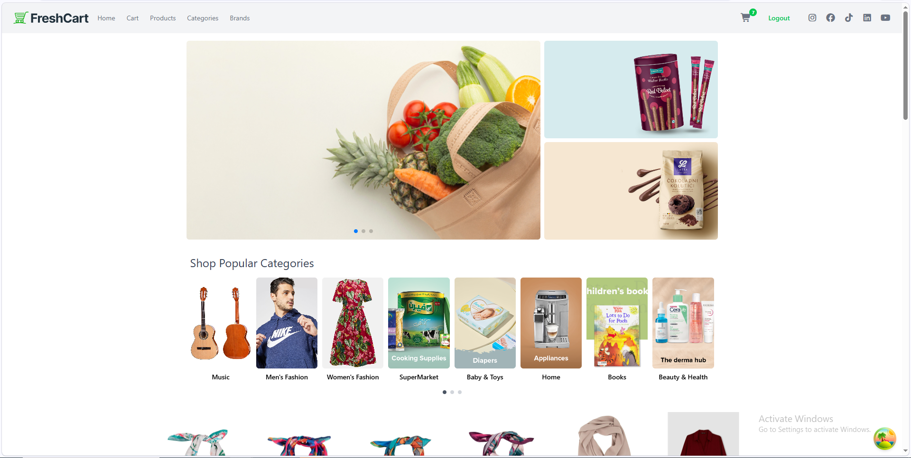

<div align="center">

# 🛒 FreshCart | E-Commerce Web Application

A modern, responsive e-commerce platform with product browsing by category and brand, cart management and user authentication.

[](https://e-commerce-seven-eosin-51.vercel.app)


</div>

---

## 📸 Preview

<div align="center">



</div>

---

## ✨ Features

- **Product browsing and filtering** across Products, Categories and Brands pages
- **Popular categories carousel** and a promotional banner slider on the home page
- **Cart management** with a live item counter in the navbar
- **Authentication**: log in and log out
- **Responsive design** that works across mobile, tablet and desktop
- **Efficient data fetching and caching** with TanStack Query

---

## 🛠️ Tech Stack

| Area | Technologies |
|---|---|
| Frontend | React.js |
| Styling | Tailwind CSS |
| Data fetching | TanStack Query |
| Deployment | Vercel |

---

## 🔑 Demo Account

Use this account to try the live app without signing up:

| Email | Password |
|---|---|
| `reem@example.com` | `Reem2026` |

---

## 🚀 Getting Started

```bash
# 1. Clone the repository
git clone https://github.com/Reem-Osama11/[repo-name].git

# 2. Move into the project folder
cd [repo-name]

# 3. Install dependencies
npm install

# 4. Start the development server
npm run dev
```

> If your project was created with Create React App, use `npm start` instead of `npm run dev`.

<!-- If the project needs environment variables, add them here, for example:
Create a `.env` file in the root folder:
VITE_API_URL=your_api_url
-->

---

## 📁 Project Structure

```
src/
├── components/   # Reusable UI components
├── pages/        # App pages
├── hooks/        # Custom hooks
└── ...
```

<!-- Replace this with your real folder structure, or delete the section. -->

---

## 📫 Contact

**Reem Osama**, Junior Frontend Developer
[LinkedIn](https://www.linkedin.com/in/reemosama-dev) · [Email](mailto:reemosama111111@gmail.com)
